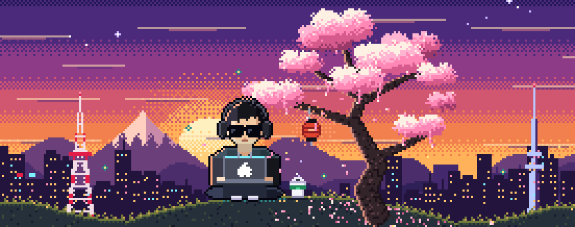
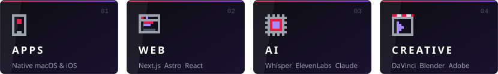

<!-- GitHub profile · DRAFT: review the TODOs before publishing. Regenerate animated SVGs with: python3 tools/build_assets.py -->

I build **apps, websites and AI-powered tools**, and I also edit video, model in 3D and design. I like to combine both worlds: software that generates and processes creative content.

<!-- TODO: confirm the real list and remove anything you don't use daily -->

 

